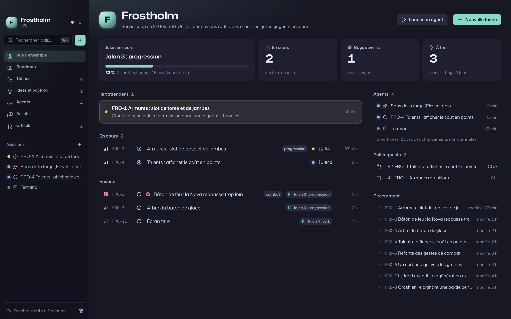
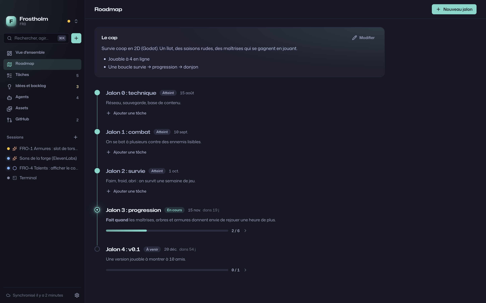
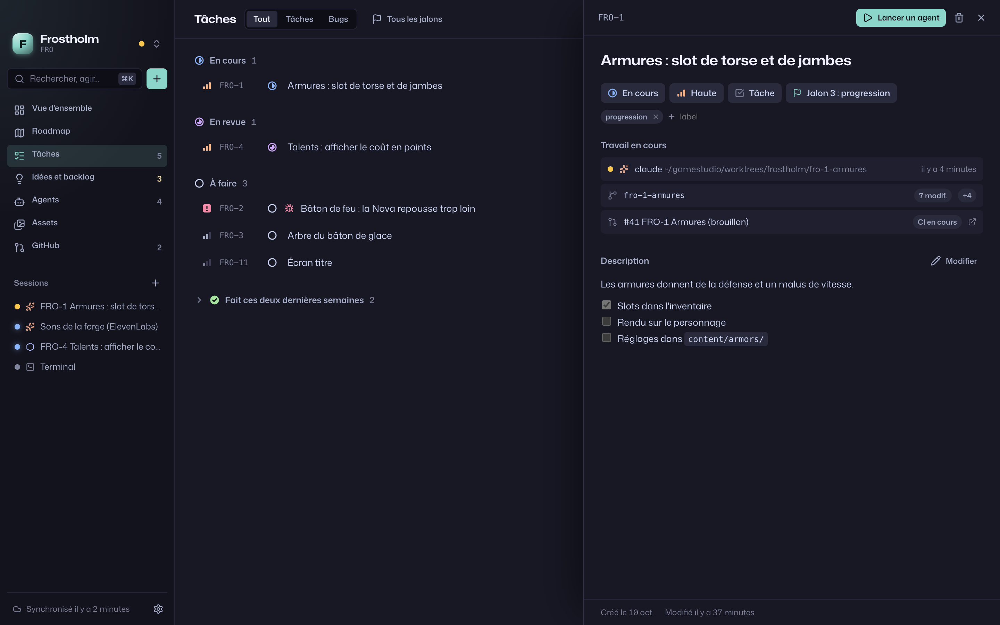
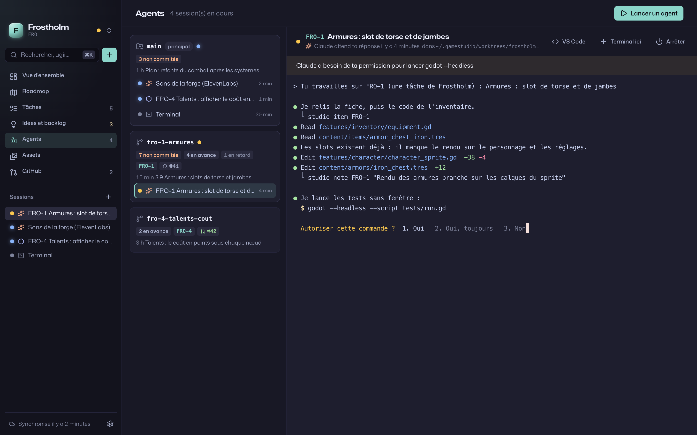
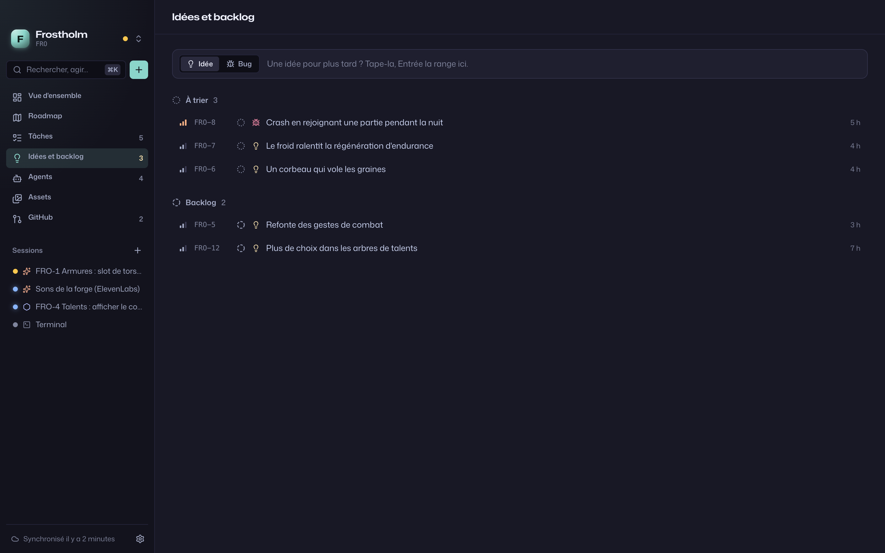
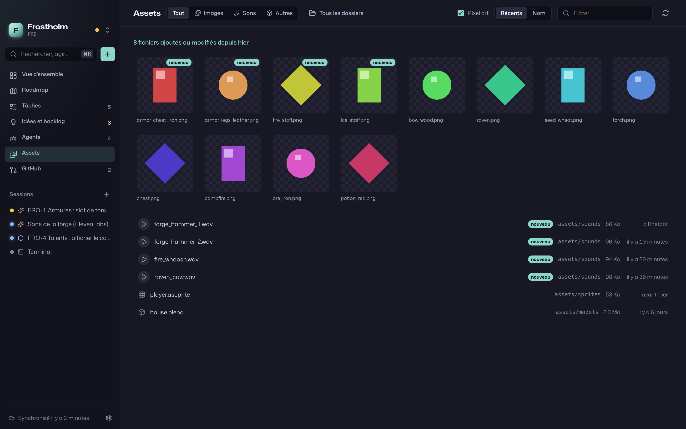
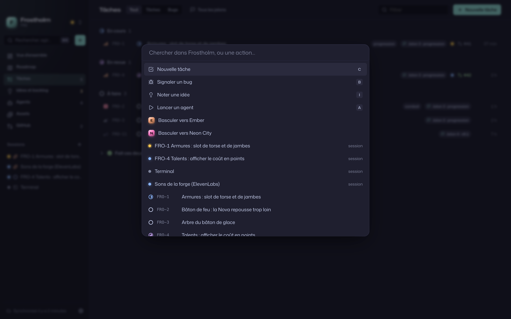

# Gamestudio

**English** | [Français](README.fr.md)

A macOS workbench for making games with coding agents. Your game's roadmap, tasks, bugs and ideas, the Claude Code
or Codex sessions working on them with their worktrees and pull requests, and the game's art and sounds: one game at
a time, in one window.



> The interface is in French for now. Gamestudio runs on Apple Silicon Macs.

## What it does

- **One game at a time.** A switcher (⌥1–9) moves between your games; everything else belongs to the current one,
  and the window takes its color.
- **Roadmap.** The game's pitch and objectives, then milestones with their "done when", due date and progress.
- **Tasks, bugs, ideas.** Drop an idea or a bug in one line, triage it later into the backlog or the plan, and follow
  what is in progress, in review and done.
- **Agents.** Start Claude Code, Codex or a plain terminal on a task, in the main checkout or a fresh worktree. Every
  worktree shows its branch, uncommitted changes and pull request; every agent shows whether it works, waits on you
  or rests. Terminals live in tmux, so agents keep running when you quit the app.
- **Assets.** The game's images and sounds, newest first, so what a background agent just generated shows up.
- **GitHub.** The repo's pull requests, their checks and reviews, linked to the tasks they close.
- **Data that travels with the game.** The tracker lives on a `gamestudio` branch of the game's own repo, one
  Markdown file per item. Clone the game on another Mac, add it, and its roadmap is back.
- **Built for agents.** The `studio` command gives an agent its task and lets it log progress or park an idea, and
  "Configurer avec Claude" lets Claude read a game's repo and fill the roadmap once you approve.

## A tour

| | |
| --- | --- |
|  **Roadmap.** The pitch, then milestones on a rail: done, current, next. |  **Tasks.** Status, priority and milestone change in place; a task opens on the side with its description and the work linked to it. |
|  **Agents.** Worktrees with their state and sessions; the selected agent's terminal, and what it waits for. |  **Ideas and backlog.** One-line capture, then triage: backlog, plan, or drop. |
|  **Assets.** Images on a checkerboard, crisp for pixel art; sounds play in place. |  **⌘K.** Any task, view, game or action, from the keyboard. |

## How it works

### The tracker lives in your game's repo

Each game's data sits on an orphan `gamestudio` branch of its repo: it shares no history with your code and never
touches your working tree or `main`. Gamestudio keeps a small clone of that branch in `~/.gamestudio/data/<game>`:

```
project.md            name, item key, color, asset folders, the game's pitch and objectives
milestones/demo.md    a milestone: status, due date, "done when"
items/FRO-12.md       a task, bug or idea
```

An item is plain Markdown with a TOML header, readable and editable by hand:

```markdown
+++
title = "Armor: chest and legs slots"
kind = "task"
status = "doing"
priority = "high"
milestone = "milestone-3"
+++

Armor adds defense and slows you down.

- [x] Inventory slots
- [ ] Shown on the character
```

Changes are committed and pushed a few seconds after you make them, and other machines' changes come in every three
minutes. When two Macs edit the same item, git merges them line by line; where they disagree on a line, the machine
syncing wins and the other version stays in the history. Where the repo sits on each Mac is kept locally
(`~/.gamestudio/repos.json`).

### Agents run in tmux

Every session runs in Gamestudio's own tmux server, shown in the app through xterm.js. Quitting or updating the app
leaves agents running; `tmux -L studio attach` reaches them from any terminal. An agent started on a task gets the
task as its brief, and a session in a new worktree gets a branch named after the task (`fro-12-armor`), so its pull
request links back. Claude Code is launched with hooks (through `--settings`, your global settings stay untouched)
that tell the app when it works, waits for you or is done: a waiting agent pulses amber and counts on the Dock icon.
After a reboot, one click resumes a session's Claude conversation.

### The `studio` command

The app's binary doubles as a command line, for you and for agents. Sessions started from the app have it on their
PATH:

```sh
studio items                        # what is open in the game of the current folder
studio item FRO-12                  # one task, in full
studio note FRO-12 "chest slot done, legs next"
studio status FRO-12 review
studio idea "a raven that steals seeds"
studio import plan.json --dry-run   # a whole plan (milestones, items, settings), previewed
studio help                         # everything else
```

### Let Claude set a game up

"Configurer avec Claude" starts a Claude session in the game's repo that follows `studio guide setup`. Claude reads
the repo (plans, design docs, git history, pull requests, TODOs, asset folders), asks you the questions that change
the plan, shows a preview with `studio import --dry-run`, and writes nothing until you agree.

### Updates

Releases are built by GitHub Actions. The installed app looks for a new one at startup and every six hours (through
`gh`), installs it in place and sends a notification asking you to restart; agents keep running meanwhile.

## Requirements

- An Apple Silicon Mac
- `git`, `tmux`, and the [GitHub CLI](https://cli.github.com) signed in (`gh auth login`)
- [Claude Code](https://claude.com/claude-code) and/or Codex for the agents
- Your games in git repos

## Install

```sh
curl -fsSL https://raw.githubusercontent.com/nihiloproxima/gamestudio/main/scripts/install.sh | bash
```

This installs the latest release in `/Applications`, the `studio` command in `~/.local/bin` and the Claude Code skill
in `~/.claude/skills`. Both point inside the app, so updates carry them along. From a clone, `pnpm app:install`
builds and installs from source instead.

## First steps

1. **Add a game.** Point at its repo, and give it a name and a key for its items (`FRO` gives `FRO-1`, `FRO-2`…).
   If the repo already has a `gamestudio` branch, its data comes back as it is.
2. **Fill it.** Let Claude do it from the repo ("Configurer avec Claude"), or create milestones in the roadmap,
   tasks with <kbd>C</kbd>, bugs with <kbd>B</kbd> and ideas with <kbd>I</kbd>.
3. **Start an agent** on a task with <kbd>A</kbd>: Claude, Codex or a terminal, in the main checkout or a new
   worktree. When it needs you, its dot turns amber.
4. **Add your other games** in Settings, "Nouveau jeu", or with `studio project add` from their repo.

| Shortcut | |
| --- | --- |
| <kbd>⌘K</kbd> | search and actions |
| <kbd>⌘1</kbd>–<kbd>⌘7</kbd> | overview, roadmap, tasks, ideas, agents, assets, GitHub |
| <kbd>⌥1</kbd>–<kbd>⌥9</kbd> | switch game |
| <kbd>C</kbd> <kbd>B</kbd> <kbd>I</kbd> | new task, bug, idea |
| <kbd>A</kbd> | start an agent |
| <kbd>J</kbd> <kbd>K</kbd> <kbd>Enter</kbd> | move through a list, open |
| <kbd>/</kbd> | filter |

## Development

```sh
pnpm install
pnpm tauri dev                 # the app
pnpm dev                       # the UI alone in a browser, on a fictional demo studio
pnpm exec vue-tsc --noEmit && (cd src-tauri && cargo test)
scripts/screenshots.sh         # regenerates these screenshots from the demo
pnpm release 0.2.0             # from main: bumps, tags and pushes; CI publishes the release
```

Tauri 2 with a Rust core and a Vue 3 interface. The architecture is described in [CLAUDE.md](CLAUDE.md).

## License

[MIT](LICENSE)
